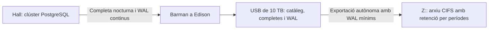

# Operació de les còpies PostgreSQL de Hall amb Barman

Aquest runbook descriu la configuració, la programació nocturna, la retenció, el seguiment,
les incidències i la recuperació de les còpies de Hall. Inclou l'arxiu de completes al recurs
de xarxa Z: i les operacions d'aturada i represa del servei.

!!! warning "Còpies físiques de tot el clúster"

    `energetica` és el nom del servidor configurat a Barman. Les còpies físiques inclouen
    **tot el clúster PostgreSQL**, no només la base de dades amb aquest nom. Una restauració
    física també restaura el clúster; per extreure'n una sola base cal un procediment addicional.

## 1. Estat de la implementació

Estat documentat el **26 de novembre de 2026**:

| Element | Evidència o estat |
|---|---|
| Versions observades | PostgreSQL 15.4 a Hall i Barman 3.21.0 a Edison |
| Còpia primària | Una completa acabada i els controls de `barman check` correctes |
| Exemple comprovat | `20261126T010054`: inici a les 01:00:54 UTC i final a les 04:49:19 UTC; unes 3 h 48 min |
| Programació trobada | Script propi: còpia diària a les 02:00 de Madrid; no la inicia `/etc/cron.d/barman` |
| Configuració preparada | Zona general `Europe/Madrid`, retenció de 7 completes i redundància mínima de 3 |
| Arxiu a Z: | Exportador implementat, 13 proves correctes i marcador de xarxa preparat |
| Pendent de confirmar | Redeploy dels canvis, primera exportació real a Z: i prova real de restauració |

La validació de codi i el `healthcheck` del contenidor no acrediten que una còpia a Z: s'hagi
completat ni que s'hagi provat la recuperació. Les opcions següents descriuen **la configuració
preparada als fitxers**; després del redeploy cal contrastar-les amb el contenidor en execució.

## 2. Arquitectura, rutes i fitxers



| Element | Valor |
|---|---|
| Servei | Barman desplegat amb Dokploy / Docker Swarm a Edison |
| Nom a Barman | `energetica` |
| Origen | `gw.lenergetica.gisce.cloud:5444` |
| Rol de connexió i streaming | `barman_backup` |
| Mètode | `backup_method = postgres`, amb `pg_basebackup` |
| Replication slot | `barman_energetica`, amb `create_slot = auto` |
| USB a Edison | `/mnt/wd10tb/copies/barman` |
| USB dins del contenidor | `/var/lib/barman` |
| Marcador de l'USB | `/mnt/wd10tb/copies/barman/.barman-storage-ready` |
| Bloqueigs locals | Volum `barman-locks`, muntat a `/var/lib/barman-locks` |
| Credencial libpq | `/var/lib/barman-locks/.pgpass`, generada des d'un secret de Swarm |
| Z: a Edison | `/mnt/file_copies/Hall/energetica_db` |
| Z: dins del contenidor | `/var/lib/barman-archive` |
| Marcador de Z: | `.barman-archive-ready`, dins del destí |

La ruta `/mnt/barman` que figurava en versions anteriors del document no és el bind mount
que utilitza el Compose revisat. Cal contrastar sempre els muntatges abans de manipular dades.
No s'ha verificat una capacitat o quota útil de Z:; cal comprovar-la a l'emmagatzematge.

### Fitxers de desplegament

El codi de referència és a
[`infra/barman` del monorepo privat](https://github.com/lenergetica/le-monorepo/tree/CU-869f4rkmj_Implementar-backup-hall/infra/barman).
La còpia local revisada i modificada durant aquesta sessió és `/home/joseantonioarias/barman`.
Cal traslladar els canvis al repositori que consumeix Dokploy abans de desplegar-los.

| Fitxer | Funció |
|---|---|
| `compose.edison-dokploy.yml` | Imatge, instal·lació de Barman, variables, volums, secrets i configs de Swarm |
| `barman-entrypoint.sh` | Comprova el marcador USB, genera `.pgpass` i prepara l'usuari `barman` |
| `barman-scheduler.sh` | Programa la còpia diària, el manteniment i el procés d'arxiu en paral·lel |
| `barman-archive.py` | Exporta completes i aplica la retenció per períodes a Z: |
| `config/barman.conf` | Rutes globals i directori local de bloqueigs |
| `config/energetica.conf` | Connexió, streaming, slot i retenció primària |
| `tests/test_archive.py` | Proves de la selecció de còpies i dels casos de fallada de l'arxiu |
| `README.md` | Instruccions tècniques al costat del desplegament |

No es dupliquen els scripts a la KB: la seva font de veritat és el desplegament. Les configs de
Swarm són immutables; quan en canvia el contingut també cal versionar-ne el nom al Compose.
Els noms preparats són `barman_entrypoint_v3`, `barman_scheduler_v4`, `barman_archive_v1`
i `energetica_config_v4`.

## 3. Connexió a les eines d'operació

A Edison, localitzeu el contenidor actual; l'identificador canvia amb cada redeploy:

```bash
docker ps --filter 'name=_barman.' --format 'table {{.ID}}\t{{.Names}}\t{{.Status}}'
```

Definiu l'identificador retornat i una funció auxiliar al terminal. El valor entre cometes és
un **marcador de posició** que cal substituir:

```bash
BARMAN_CONTAINER='IDENTIFICADOR_DEL_CONTENIDOR'
bm() {
  docker exec --user barman "$BARMAN_CONTAINER" \
    env PGPASSFILE=/var/lib/barman-locks/.pgpass \
    barman "$@"
}
```

L'usuari de sistema `--user barman` no és el rol PostgreSQL. Els permisos SQL corresponen
al rol de `conninfo`, que aquí és `barman_backup`.

## 4. Programació nocturna i zones horàries

La configuració preparada al Compose és:

```yaml
environment:
  TZ: Europe/Madrid
  BARMAN_BACKUP_TIME: "${BARMAN_BACKUP_TIME:-02:00}"
  BARMAN_BACKUP_TIMEZONE: "${BARMAN_BACKUP_TIMEZONE:-Europe/Madrid}"
  PGPASSFILE: /var/lib/barman-locks/.pgpass
  BARMAN_ARCHIVE_ENABLED: "${BARMAN_ARCHIVE_ENABLED:-1}"
```

Dokploy pot sobreescriure les variables interpolades. La còpia diària la inicia
`barman-scheduler.sh`: si ja ha passat l'hora prevista i no consta una còpia reeixida aquell
dia, executa `barman backup energetica`. Desa el dia a
`/var/lib/barman-locks/energetica-last-backup-date`, dins del volum persistent.

- A l'hivern, les **02:00 de Madrid són la 01:00 UTC**.
- A l'estiu, les **02:00 de Madrid són les 00:00 UTC**.
- El dia del salt a l'horari d'estiu les 02:00 no existeixen: la còpia s'inicia a partir de les 03:00.
- Quan es repeteixen les 02:00 a la tardor, el registre diari evita repetir una còpia reeixida.
- Si el servei arrenca tard, fa la còpia pendent després de l'hora prevista. Si falla, torna a
  intentar-ho als cicles següents.

La variable `TZ` estableix la zona general del contenidor i de Barman. No reanomena els
identificadors antics, generats quan el procés utilitzava UTC. La variable
`BARMAN_BACKUP_TIMEZONE` controla específicament la comparació horària del planificador.

Per comprovar els valors efectius:

```bash
docker exec "$BARMAN_CONTAINER" sh -c '
  date "+%F %T %Z %z"
  TZ=Europe/Madrid date "+%F %T %Z %z"
  printenv BARMAN_BACKUP_TIME BARMAN_BACKUP_TIMEZONE
'
```

### Manteniment i verificació

`barman cron` gestiona manteniment, WAL i retenció; **no programa les completes**. El
planificador l'executa a cada iteració i espera 60 segons al final. Com que el backup i les
verificacions són síncrons, aquest bucle no executa nous cicles de manteniment mentre duren.
El receptor WAL ja iniciat és un procés independent.

El paquet també instal·la `/etc/cron.d/barman`, que pot executar manteniment si realment hi ha
un daemon cron actiu. L'existència del fitxer no acredita que s'estigui executant ni explica
la còpia nocturna.

Després de l'èxit de `barman backup`, el script registra el dia i executa `switch-wal --archive`,
`check-backup` i `verify-backup`. Si aquesta verificació falla, ho registra als logs, però el dia
ja consta com a copiat: **no es repeteix automàticament la completa només perquè falli la verificació**.

## 5. Retenció a l'USB i recuperació temporal

La decisió actual és una completa cada nit, sense consolidació diària de WAL ni incrementals:

```ini
retention_policy = REDUNDANCY 7
minimum_redundancy = 3
```

- `REDUNDANCY 7` conserva les 7 últimes completes vàlides; quan n'hi ha una vuitena, l'antiga
  passa a ser eliminable durant el manteniment.
- `minimum_redundancy = 3` estableix el mínim protegit davant d'eliminacions gestionades per
  Barman. `barman check` avisa mentre no hi hagi almenys tres completes vàlides. No les crea.
- La retenció es basa en còpies `DONE`. Les interrompudes, `FAILED` o `WAITING_FOR_WALS`
  requereixen seguiment i no substitueixen completes vàlides en el recompte.

No és el mateix que una finestra de 7 dies: si canvia la freqüència o fallen còpies, l'edat de
les set conservades canvia. `RECOVERY WINDOW OF 7 DAYS` conservaria la base anterior i els WAL
necessaris per cobrir tota aquella finestra, encara que calguessin més còpies.

### WAL i recuperació a un instant concret

La recepció contínua de WAL permet recuperar instants posteriors a una còpia base, fins al punt
cobert pels WAL disponibles. Per recuperar qualsevol instant de l'últim dia cal una base vàlida
anterior al punt escollit i una cadena completa de WAL fins a aquell punt.

No cal una completa cada pocs minuts. Tampoc es pot retrocedir una còpia aplicant WAL: només
permeten avançar. El retard d'arxivament determina el punt més recent recuperable; rebre WAL
no prova per si sol que tota la cadena sigui recuperable.

S'han descartat de moment la consolidació diària a Edison i les còpies completes només setmanals.
PostgreSQL 15 no disposa dels incrementals natius de blocs incorporats a PostgreSQL 17.

## 6. Comprovacions habituals

```bash
bm check energetica
bm list-backups energetica
bm list-processes energetica
```

Per veure els detalls d'una còpia, substituïu `ID_COPIA` pel seu identificador:

```bash
bm show-backup energetica ID_COPIA
```

| Indicador | Interpretació |
|---|---|
| `F` a `list-backups` | Còpia completa, de tipus *full* |
| Identificador `YYYYMMDDTHHMMSS` | Data i hora d'inici segons la zona del procés que la va crear |
| Data de la línia d'una completa acabada | Hora de finalització, no d'inici |
| `Begin time` / `End time` a `show-backup` | Inici i final detallats; contrastar la zona horària |
| `STARTED` | Inici registrada al catàleg; no prova que el procés continuï actiu |
| `WAITING_FOR_WALS` | Falten WAL necessaris per donar la còpia per completa |
| `DONE` | Còpia completada segons Barman; cal provar igualment la restauració |
| `receive-wal` | Receptor continu de WAL; pot estar actiu sense una completa en curs |

La còpia observada `20261126T010054` va acabar a les 04:49:19 UTC del 26/11, és a dir,
a les 05:49:19 de Madrid. L'identificador correspon a les 02:00:54 de Madrid. No es va
iniciar a les 04:49.

Per consultar logs recents:

```bash
docker logs --since 30m --tail 200 "$BARMAN_CONTAINER"
```

Si algun component escriu a fitxer, la seva sortida pot no aparèixer a `docker logs`.
Els controls d'antiguitat mostraven `no last_backup_maximum_age provided` i
`no last_wal_maximum_age provided`: sense llindars, aquells `OK` no certifiquen frescor.
Reviseu les dates i superviseu també el resultat de l'arxiu, que el `healthcheck` actual no comprova.

## 7. Seguiment des de PostgreSQL

Executeu a la instància origen, amb permisos suficients:

```sql
SELECT
    pid,
    phase,
    backup_streamed,
    pg_size_pretty(backup_streamed) AS transferit,
    pg_size_pretty(backup_total) AS total_estimat,
    round(100.0 * backup_streamed / NULLIF(backup_total, 0), 1) AS percentatge
FROM pg_stat_progress_basebackup;
```

Repetiu-la al cap de 10–60 segons; a `psql`, `\watch 10` la repeteix cada 10 segons.
Una captura única no demostra que s'estigui avançant. El percentatge és estimat.

Els textos següents són **valors de la columna `phase`**, no columnes independents:

| Valor de `phase` | Interpretació |
|---|---|
| `streaming database files` | Transfereix dades; `backup_streamed` hauria d'augmentar |
| `waiting for checkpoint to finish` | Espera el checkpoint inicial; pot trigar sense transferir dades |
| `estimating backup size` | Estima la mida de la còpia |
| `waiting for wal archiving to finish` | Espera l'arxivament necessari per finalitzar |
| `transferring wal files` | Transfereix els WAL en un mode que inclou aquesta fase |

**Zero files** indica que no hi ha un `BASE_BACKUP` actiu a aquella instància en aquell moment.
La vista no mostra historial, còpies per `rsync` ni còpies executades en una altra rèplica.
És una vista de tota la instància, no només de la base a la qual s'ha connectat el client.

### Quan només es disposa d'accés SQL

Per identificar la instància i les connexions relacionades:

```sql
SELECT inet_server_addr() AS servidor, inet_server_port() AS port,
       current_user AS usuari, pg_is_in_recovery() AS es_replica;

SELECT pid, usename, application_name, client_addr, backend_type,
       state, wait_event_type, wait_event, query
FROM pg_stat_activity
WHERE backend_type = 'walsender'
   OR application_name ILIKE '%barman%'
   OR application_name ILIKE '%basebackup%'
   OR query ILIKE 'BASE_BACKUP%';
```

`barman_receive_wal` és coherent amb una sessió de recepció de WAL; no acredita una completa
ni que l'arxiu remot sigui correcte. `<insufficient privilege>` i camps ocults indiquen falta
de permisos de visibilitat. Amb aquestes consultes no es pot confirmar l'última còpia `DONE`:
cal consultar el Barman corresponent. No s'han de traslladar automàticament a PRO les dades de Hall.

## 8. Incidències i còpies interrompudes

### Permisos de les funcions de backup

Si `barman check` retorna `no access to backup functions`, comproveu els permisos efectius del
rol de `conninfo`, a la base indicada per aquesta connexió:

```sql
SELECT p.oid::regprocedure AS funcio,
       has_function_privilege('barman_backup', p.oid, 'EXECUTE') AS te_permis
FROM pg_proc p
JOIN pg_namespace n ON n.oid = p.pronamespace
WHERE n.nspname = 'pg_catalog'
  AND p.proname IN ('pg_backup_start', 'pg_backup_stop',
                   'pg_switch_wal', 'pg_create_restore_point')
ORDER BY 1;

SELECT pg_has_role('barman_backup', 'pg_read_all_settings', 'USAGE') AS configuracio,
       pg_has_role('barman_backup', 'pg_read_all_stats', 'USAGE') AS estadistiques;
```

Aquestes consultes només llegeixen. Si falten permisos, un administrador pot concedir els
corresponents a PostgreSQL 15, segons els prerequisits de Barman:

```sql
GRANT EXECUTE ON FUNCTION pg_catalog.pg_backup_start(text, boolean) TO barman_backup;
GRANT EXECUTE ON FUNCTION pg_catalog.pg_backup_stop(boolean) TO barman_backup;
GRANT EXECUTE ON FUNCTION pg_catalog.pg_switch_wal() TO barman_backup;
GRANT EXECUTE ON FUNCTION pg_catalog.pg_create_restore_point(text) TO barman_backup;
GRANT pg_read_all_settings TO barman_backup;
GRANT pg_read_all_stats TO barman_backup;
```

El rol de streaming també necessita els permisos de replicació corresponents. Un control
`PostgreSQL streaming: OK` no implica tenir els permisos de les funcions de backup.

### `STARTED` després d'un redeploy

No feu redeploy durant una completa si es pot evitar. Una aturada abrupta pot deixar una entrada
`STARTED` encara que el procés ja no existeixi. Primer consulteu `list-processes`, `show-backup`,
els logs i el progrés SQL; si els bytes augmenten, deixeu acabar la còpia.

El contenidor pot no tenir `ps`. Per inspeccionar un PID intern conegut, substituïu `PID_INTERN`:

```bash
docker exec "$BARMAN_CONTAINER" sh -c '
  if [ -d /proc/PID_INTERN ]; then
    tr "\000" " " < /proc/PID_INTERN/cmdline
    echo
    cat /proc/PID_INTERN/status
  else
    echo "El procés ja no existeix"
  fi
'
docker top "$BARMAN_CONTAINER"
```

Els PID de `docker top` poden ser els de l'amfitrió, diferents dels interns. No executeu
`kill -9 PID` a Edison assumint que és el mateix procés. `SIGKILL` impedeix la neteja normal.
Si s'ha confirmat que cal cancel·lar una completa encallada, utilitzeu primer:

```bash
bm terminate-process energetica backup
bm list-processes energetica
```

No atureu `receive-wal` per desbloquejar una completa. Si el procés ja no existeix, i s'ha
comprovat que cap altre contenidor accedeix al mateix repositori fent aquella operació,
Barman pot netejar locks sense ús:

```bash
bm lock-directory-cleanup
```

No esborreu locks manualment mentre hi pugui haver processos actius. Una vegada confirmat que
l'intent antic no està actiu i que hi ha una completa recent `DONE`, es pot eliminar **només
l'intent interromput**, després de revisar l'identificador:

```bash
bm show-backup energetica ID_INTERROMPUT
bm delete energetica ID_INTERROMPUT
bm list-backups energetica
```

L'intent `20261125T112409` es va identificar com a candidat a aquesta neteja. No consta en
la sessió que s'hagi eliminat efectivament. Barman pot impedir eliminacions si es vulnera la
redundància mínima; no la rebaixeu sense valorar les còpies que queden.

## 9. Segona còpia autònoma a Z:

### Decisió i abast

S'utilitza `barman export-backup` més un exportador amb retenció pròpia, en lloc de replicar
tot el repositori amb `rsync --delete` o mantenir un segon Barman amb WAL continus. L'objectiu de Z:
és conservar punts complets històrics amb una retenció diferent de l'USB.

Cada tar conté les dades, les metadades i els WAL mínims necessaris per fer consistent aquella
completa. **«Sense WAL continus» no significa eliminar aquests WAL mínims.** Sense l'historial
posterior, Z: permet recuperar el punt de la còpia, però no qualsevol instant entre dues còpies.

L'exportació llegeix l'USB, sense tornar a copiar les dades des de Hall. Només admet completes
`DONE`, i Barman bloqueja la còpia d'origen durant la lectura. No s'ha activat compressió de
l'exportació per defecte. La primera execució pot haver d'exportar diverses còpies de centenars
de GB; cal comptar la transferència i les lectures de verificació a la xarxa.

### Retenció per períodes

Es conserva la unió dels punts següents, amb dates de finalització interpretades a Madrid:

| Nivell | Regla implementada |
|---|---|
| Recents | Les 7 últimes completes disponibles |
| Setmanals | La més recent de cada setmana ISO: l'actual i les 9 anteriors |
| Mensuals | La més recent de cada mes natural: l'actual i els 11 anteriors |
| Semestrals | La més recent de cada semestre natural entre les còpies de més d'un any |

Els semestres són gener–juny i juliol–desembre. Les semestrals no tenen caducitat final en la
implementació preparada. Una còpia pot cobrir diversos nivells sense duplicar-se.
Els períodes sense còpies queden buits: no es reconstrueix historial que ja s'hagi eliminat.
Aquesta és una selecció de punts històrics, no una garantia de recuperació contínua durant anys.

### Estructura i comprovacions

```text
energetica_db/
├── .barman-archive-ready
├── .incomplete/
│   └── ID_COPIA/
└── backups/
    └── ID_COPIA/
        ├── backup-export-energetica-ID_COPIA-DATA_EXPORT-CHECKSUM.tar
        └── archive.json
```

L'exportador comprova el catàleg cada 15 minuts, a més del temps que trigui cada passada.
Abans d'operar exigeix el marcador i un sistema de fitxers CIFS/NFS visible al contenidor.
El lock de l'exportador es desa al volum local de bloqueigs.

Els tar s'escriuen a `.incomplete/`. Barman genera el seu checksum i l'exportador torna a
llegir el fitxer al recurs, comprova el hash del nom i desa el SHA-256 complet al rebut.
Després publica la carpeta a `backups/`. Una transferència parcial no compta com a còpia acabada.
No es fa una lectura íntegra de tots els arxius històrics a cada passada.

La neteja només gestiona carpetes pròpies amb rebut reconegut, i es fa després de completar
totes les exportacions requerides. Un error interromp la passada abans de continuar la neteja.
Si queda un tar amb checksum incorrecte o un pendent sense origen disponible, cal revisió manual.

!!! warning "Supervisar el retard de l'arxiu"

    L'avaria de Z: no atura les còpies nocturnes ni la retenció de l'USB. Si una completa desapareix
    de l'USB abans de ser exportada, es perd aquell punt a Z:. Cal supervisar les exportacions
    pendents i els errors; la salut del contenidor no cobreix aquest control.

### Preparació, activació i simulació

Comproveu el muntatge abans de crear el marcador; no el creeu sobre un directori local que
substitueixi accidentalment el recurs remot:

```bash
findmnt -T /mnt/file_copies/Hall/energetica_db
touch /mnt/file_copies/Hall/energetica_db/.barman-archive-ready
```

El marcador ja es va preparar durant aquesta sessió, després de confirmar el CIFS. El Compose
ha de muntar aquest directori a `/var/lib/barman-archive`. L'entrypoint afegeix `barman` al grup
que presenta el muntatge, sense canviar-ne propietaris ni permisos. Els permisos SMB han de
permetre crear, llegir, escriure, reanomenar i eliminar al destí.

Després de traslladar els fitxers al repositori de desplegament, fer redeploy a Dokploy amb
`BARMAN_ARCHIVE_ENABLED=1`. La primera exportació s'inicia automàticament quan hi ha completes
disponibles. Per desactivar només l'arxiu, establir `BARMAN_ARCHIVE_ENABLED=0` i redesplegar.

Per simular les decisions sense exportar ni eliminar:

```bash
docker exec --user barman "$BARMAN_CONTAINER" \
  env PGPASSFILE=/var/lib/barman-locks/.pgpass \
  python3 /usr/local/bin/barman-archive --dry-run
```

Si l'exportador automàtic té el lock, la simulació informa que ja hi ha una execució activa.
Per revisar els missatges:

```bash
docker logs --since 1h --tail 300 "$BARMAN_CONTAINER"
ls -lh /mnt/file_copies/Hall/energetica_db/backups
```

El tar conserva obligatòriament el seu nom original: Barman utilitza el checksum inclòs al nom
en importar. El rebut associa la data, la mida i el SHA-256 complet amb aquella exportació.

## 10. Recuperació i prova de restauració

Una còpia `DONE`, un checksum correcte i una prova de codi no substitueixen una restauració real.
Prepareu una instància de prova aïllada, amb PostgreSQL compatible i espai suficient per a
l'extracció i els WAL. No restaureu sobre la instància de Hall en servei.

### Des de l'USB

Aquests exemples preparen les dades en una ruta **del contenidor Barman**. Cal proporcionar
un volum de restauració separat i persistent, writable per `barman`; `/ruta/restauracio` és un
marcador de posició i no és un volum definit al Compose actual.

Per restaurar una completa:

```bash
bm restore energetica ID_COPIA /ruta/restauracio
```

Per arribar a un instant concret, trieu una còpia vàlida anterior i confirmeu que tots els WAL
necessaris són disponibles. Exemple de sintaxi, no una recuperació executada:

```bash
bm restore --target-time '2026-11-26 05:00:00+01:00' \
  energetica ID_COPIA_ANTERIOR /ruta/restauracio
```

Explicitar l'offset evita ambigüitats de zona horària. Barman prepara les dades i la configuració
de recuperació; després cal iniciar PostgreSQL de prova amb la configuració adequada,
comprovar que arriba a l'objectiu i validar les dades de l'aplicació. Mesureu el temps total.

### Des de Z:

Prepareu una instal·lació o catàleg Barman de recuperació per al mateix clúster (`systemid`).
Si l'identificador ja existeix al catàleg habitual, feu servir un catàleg separat. Presenteu-hi
el tar de Z: sense reanomenar-lo. Les ordres següents s'executen **en aquell entorn de recuperació**:

```bash
barman import-backup energetica /ruta/backup-export-energetica-ID_COPIA-DATA_EXPORT-CHECKSUM.tar
barman show-backup energetica ID_COPIA
barman verify-backup energetica ID_COPIA
barman restore energetica ID_COPIA /ruta/postgresql-restaurat
```

La importació comprova el checksum i registra la còpia com a `KEEP:STANDALONE`. Reviseu aquesta
marca si després voleu sotmetre la còpia a la retenció ordinària. Completeu la prova iniciant
PostgreSQL aïllat i comprovant les dades. No hi ha constància d'una prova real d'aquest circuit
a Z: en aquesta sessió.

## 11. Aturada, manteniment i represa

### Pausa curta o redeploy ordinari

Comproveu primer `bm list-processes energetica` i el progrés SQL. Espereu que acabi la completa
abans de redesplegar. Una pausa curta amb capacitat suficient de WAL pot mantenir el replication
slot: en reprendre, Barman rep el que hagi quedat pendent.

La retenció de WAL pel slot pot ocupar espai al servidor PostgreSQL mentre el receptor està
aturat. La durada acceptable depèn del ritme de canvis i de l'espai disponible, no d'un nombre
fix de minuts. No elimineu el slot només per un redeploy ordinari.

### Aturada llarga i eliminació deliberada del slot

Si no es pot assegurar prou espai per retenir els WAL pendents, es pot aturar Barman i eliminar
el slot. **Això trenca la continuïtat de recuperació durant la pausa**: en reprendre cal una
base nova. No és una operació rutinària sense conseqüències.

1. Atureu el servei/stack a Dokploy, després de comprovar que no queda una completa activa.
2. A PostgreSQL, amb un administrador, confirmeu que el slot ja no és actiu:

    ```sql
    SELECT slot_name, active
    FROM pg_replication_slots
    WHERE slot_name = 'barman_energetica';
    ```

3. Només quan sigui inactiu, i acceptant la discontinuïtat, elimineu-lo:

    ```sql
    SELECT pg_drop_replication_slot('barman_energetica');
    ```

4. Verifiqueu que la consulta del pas 2 ja no retorna files. No es modifiquen les còpies
   històriques, però no es pot recuperar a través d'un buit de WAL amb una base anterior.

### Reprendre després de trencar la cadena

Inicieu el servei a Dokploy i torneu a identificar el contenidor. `create_slot = auto` permet
recrear el slot quan s'inicia la recepció. Podeu activar el manteniment immediatament:

```bash
bm cron
bm check energetica
```

Comproveu `PostgreSQL streaming`, `replication slot` i `receive-wal running`. Creeu una completa
nova i verifiqueu-la; abans confirmeu que no n'hi ha una de programada ja activa:

```bash
bm backup --wait --wait-timeout 300 energetica
bm switch-wal --archive energetica
bm check-backup energetica latest
bm verify-backup energetica latest
bm list-backups energetica
```

Els 300 segons limiten l'espera de WAL, no la durada de la transferència completa. Si la còpia
queda `WAITING_FOR_WALS`, encara no es pot donar per acabada. El codi de sortida i l'estat final
són els indicadors fiables de les comprovacions.

### Reinicialització destructiva

Només si s'ha decidit explícitament prescindir del catàleg, completes i WAL locals, amb el servei
aturat i el tractament del slot resolt, es pot eliminar el directori del servidor. Abans cal
verificar el muntatge, l'arxiu recuperable a Z: i l'abast de l'eliminació.

```bash
findmnt -T /mnt/wd10tb/copies/barman
sudo du -sh /mnt/wd10tb/copies/barman/energetica
```

!!! danger "Confirmació humana abans d'eliminar"

    La següent ordre elimina totes les còpies, WAL i catàleg locals de `energetica`. No l'executeu
    com a part d'una neteja ordinària ni sense confirmar abans la decisió i la ruta. No elimina
    les dades de Hall ni l'arxiu separat a Z:.

```bash
sudo rm -rf /mnt/wd10tb/copies/barman/energetica
```

## 12. Incidència històrica: escriptura directa al CIFS

La còpia gran de Hall va fallar escrivint directament al CIFS amb un error `fsync` (`Bad file
descriptor`) i missatges `CIFS: VFS: No writable handle in writepages`. Per això el repositori
primari es manté a l'USB local, amb els bloqueigs en un volum local separat.

L'arxiu preparat a Z: escriu fitxers d'exportació, en lloc d'utilitzar el CIFS com a repositori
primari viu. **Això no acredita que el problema del muntatge estigui resolt**: cal validar
l'exportació, la sincronització a disc i la restauració reals. La compressió no resol per si
mateixa un error de durabilitat del CIFS.

## 13. Validació del desplegament i punts pendents

Des del directori que conté els fitxers de desplegament:

```bash
PYTHONDONTWRITEBYTECODE=1 python3 -m unittest discover -s tests -v
sh -n barman-entrypoint.sh
sh -n barman-scheduler.sh
docker compose -f compose.edison-dokploy.yml config --quiet
```

Durant la sessió aquestes comprovacions van passar, amb 13 proves de retenció, publicació,
checksums i casos de fallada. No s'ha modificat la instància PostgreSQL ni s'han executat
ordres destructives per redactar aquest document.

Abans de considerar complet el desplegament:

- [ ] Traslladar els fitxers locals al repositori que consumeix Dokploy i revisar-ne els canvis.
- [ ] Fer redeploy fora d'una completa activa i confirmar les variables, els muntatges i les versions.
- [ ] Comprovar que s'acumulen completes `DONE` i que el mínim de tres arriba a complir-se.
- [ ] Comprovar una exportació real a Z: i el seu rebut amb checksum.
- [ ] Provar la importació, l'arrencada PostgreSQL aïllada i les dades restaurades.
- [ ] Provar la recuperació a un instant concret de l'últim dia des de l'USB.
- [ ] Supervisar l'antiguitat de les completes, el retard de WAL, l'espai i les exportacions pendents.
- [ ] Revisar periòdicament la retenció semestral indefinida i la quota útil de Z:.

## 14. Referències

- [Codi de desplegament al monorepo privat](https://github.com/lenergetica/le-monorepo/tree/CU-869f4rkmj_Implementar-backup-hall/infra/barman).
- [Ordres de Barman 3.21](https://docs.pgbarman.org/release/3.21.0/user_guide/commands.html).
- [Retenció de Barman 3.21](https://docs.pgbarman.org/release/3.21.0/user_guide/retention_policies.html).
- [Exportació i importació de còpies autònomes](https://docs.pgbarman.org/release/3.21.0/user_guide/export_import.html).
- [Permisos i prerequisits de Barman](https://docs.pgbarman.org/release/3.21.0/user_guide/pre_requisites.html).
- [Progrés de còpies base a PostgreSQL 15](https://www.postgresql.org/docs/15/progress-reporting.html).
