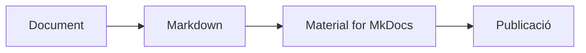

# Guia de referència de Markdown i Zensical

Aquesta pàgina és la referència principal de la Knowledge Base per crear documents amb Markdown i Zensical. Està pensada tant per a usuaris nous com per a persones que ja tenen experiència, i serveix com a guia pràctica per produir documentació clara, coherent i fàcil de mantenir.

La KB es basa actualment en Zensical i es publica a [https://edison.gcc.intranet.gencat.cat/kb](https://edison.gcc.intranet.gencat.cat/kb). Zensical pot utilitzar la configuració existent a `mkdocs.yml`. El workflow de publicació d'aquest repositori encara executa `mkdocs build`; aquest document no en modifica la configuració.

La idea no és només escriure text, sinó crear documents que siguin:

- llegibles en una pantalla i en mòbil
- fàcils de cercar
- senzills de revisar i mantenir
- consistents entre equips i projectes

---

## 1. Objectiu de la Knowledge Base

La Knowledge Base serveix per documentar i compartir coneixement sobre:

- arquitectures i solucions tècniques
- procediments i runbooks
- infraestructura i serveis
- APIs i integracions
- telecomunicacions
- seguretat
- projectes i decisions tècniques
- formació i referència interna

L'objectiu és mantenir la documentació com a codi: versionada, revisable i fàcil de consultar.

---

## 2. Què és Markdown?

Markdown és un llenguatge de marcat senzill per estructurar documents sense necessitat d'un editor visual. Permet crear títols, llistes, enllaços, taules, blocs de codi i altres elements útils per a la documentació tècnica.

### Exemple bàsic

```md
# Títol principal

## Subtítol

- Element 1
- Element 2
- Element 3

**Text en negreta** i *text en cursiva*.

[Documentació de Markdown](https://www.markdownguide.org/)
```

El resultat és:

# Títol principal

## Subtítol

- Element 1
- Element 2
- Element 3

**Text en negreta** i *text en cursiva*.

[Documentació de Markdown](https://www.markdownguide.org/)

Markdown és la base del contingut. Zensical és l'eina actual per generar i publicar el lloc; Material for MkDocs correspon a l'etapa anterior de la KB.

---

## 3. Markdown bàsic: elements essencials

### 3.1 Encapçalaments

```md
# Títol principal
## Secció
### Subsecció
#### Detall
```

Es recomana mantenir una jerarquia clara i evitar salts de nivell arbitraris.

### 3.2 Èmfasi i format del text

```md
**negreta**
*italic*
~~ratllat~~
`codi inline`
```

Resultat visual:

**negreta**
*italic*
~~ratllat~~
`codi inline`

### 3.3 Llistes

#### Llista no ordenada

```md
- Primer element
- Segon element
- Tercer element
```

Resultat visual:

- Primer element
- Segon element
- Tercer element

#### Llista ordenada

```md
1. Primer pas
2. Segon pas
3. Tercer pas
```

Resultat visual:

1. Primer pas
2. Segon pas
3. Tercer pas

#### Llista de tasques

```md
- [x] Documentació actualitzada
- [ ] Revisar punts pendents
- [ ] Confirmar informació crítica
```

Resultat visual:

- [x] Documentació actualitzada
- [ ] Revisar punts pendents
- [ ] Confirmar informació crítica

### 3.4 Citacions

```md
> Aquesta informació és important i cal tenir-la en compte.
```

Resultat visual:

> Aquesta informació és important i cal tenir-la en compte.

### 3.5 Enllaços

```md
[Veure SmartLogger](ot/smartlogger.md)
[GitHub](https://github.com)
```

Resultat visual:

[Veure SmartLogger](ot/smartlogger.md)
[GitHub](https://github.com)

Preferiu rutes relatives internes coherents amb la estructura del repositori.

### 3.6 Imatges

```md

```

Resultat visual:


Si la imatge aporta informació important, incloeu sempre un text alternatiu descriptiu.

### 3.7 Taules

```md
| Columna 1 | Columna 2 | Columna 3 |
|-----------|-----------|-----------|
| Valor 1   | Valor 2   | Valor 3   |
| Valor 4   | Valor 5   | Valor 6   |
```

Resultat visual:

| Columna 1 | Columna 2 | Columna 3 |
|-----------|-----------|-----------|
| Valor 1   | Valor 2   | Valor 3   |
| Valor 4   | Valor 5   | Valor 6   |

### 3.8 Blocs de codi

````md
```bash
zensical serve
```
````

Es recomana especificar el llenguatge del bloc perquè el ressaltat de sintaxi sigui correcte.

```bash
zensical serve
```

### 3.9 Codi inline

```md
La comanda per iniciar la previsualització local amb Zensical és `zensical serve`.
```

---

## 4. Funcions de Markdown i Material for MkDocs

Els exemples d'aquesta secció mostren elements visuals i estructurals utilitzats amb Material for MkDocs. Es conserven com a referència de l'etapa anterior i cal comprovar-ne la compatibilitat amb la configuració actual de Zensical abans d'introduir-los en documents nous.

### 4.1 Admonicions

```md
!!! info
    Aquesta és una nota informativa.

!!! note
    Aquesta és una nota informativa.

!!! warning
    Aquest és un avís que cal tenir en compte.

!!! tip
    Aquí podeu afegir una recomanació útil.
```

Resultat:

!!! info
    Aquesta és una nota informativa.

!!! note
    Aquesta és una nota informativa.

!!! warning
    Aquest és un avís que cal tenir en compte.

!!! tip
    Aquí podeu afegir una recomanació útil.

També podeu donar un títol explícit:

```md
!!! warning "Atenció"
    Els canvis en producció han de passar per Pull Request.
```

Resultat:

!!! warning "Atenció"
    Els canvis en producció han de passar per Pull Request.

### 4.2 Blocs desplegables

```md
??? info "Veure més detalls"
    Aquí es pot afegir informació addicional.
```

Resultat:

??? info "Veure més detalls"
    Aquí es pot afegir informació addicional.

### 4.3 Pestanyes

La sintaxi de pestanyes utilitzada a la KB és aquesta:

````md
=== "Windows"
    ```powershell
    zensical serve
    ```

=== "Linux/macOS"
    ```bash
    zensical serve
    ```
````

Resultat visual:

=== "Windows"
    ```powershell
    zensical serve
    ```

=== "Linux/macOS"
    ```bash
    zensical serve
    ```

### 4.4 Emoji i iconografia

```md
:warning: Atenció
:rocket: Implementació
:check: Validat
```

Resultat visual:

:warning: Atenció
:rocket: Implementació
:check: Validat

### 4.5 Llistes de tasques interactives

```md
- [ ] Revisar el document
- [x] Aplicar el canvi
- [ ] Validar el resultat
```

Resultat visual:

- [ ] Revisar el document
- [x] Aplicar el canvi
- [ ] Validar el resultat

### 4.6 Codi amb còpia ràpida

La configuració del site habilita un botó de còpia en els blocs de codi per facilitar la reutilització de comandes.

```bash
echo "Exemple de codi"
```

Resultat visual:

```bash
echo "Exemple de codi"
```

### 4.7 Tecles ràpides

Material també permet mostrar tecles de teclat amb estil:

```md
Prem ++ctrl+c++ per copiar.
Prem ++ctrl+v++ per enganxar.
```

Resultat visual:

Prem ++ctrl+c++ per copiar.
Prem ++ctrl+v++ per enganxar.

---

## 5. Diagrames amb Mermaid

Material for MkDocs permet incloure diagrames Mermaid dins dels documents. La sintaxi és la següent:

````md

````

Resultat visual:


Els diagrames són útils quan el flux, l'arquitectura o les relacions entre components són difícils de transmetre només amb text.

---

## 6. Metadades del document (YAML Front Matter)

Cada fitxer pot incloure metadades a l'inici en format YAML. Aquestes dades ajuden a classificar, revisar i gestionar la documentació del repositori.

Agrupeu `author` i `reviewed_by` per distingir l'autoria original de qui ha fet
l'última actualització o revisió. Manteniu també juntes les dates, en aquest ordre: `creation_date` i
`review_date`, seguides de `review_after_months`.
Totes les dates s'escriuen entre cometes amb el format `YYYY-MM-DD`. El sufix
`_date` indica que són dates sense hora.

Per coherència, poseu entre cometes dobles tots els valors de text: títols, noms,
estats, versions, dates, etiquetes i referències. En YAML les cometes són opcionals
per a molts textos, però aquesta convenció evita diferències de format i
interpretacions automàtiques com ara una versió `1.0` convertida en nombre.
Els enters, com `review_after_months: 60`, es mantenen sense cometes.

`creation_date` substitueix l'antic camp `created`; en actualitzar un document
existent, traslladeu-ne el valor sense canviar-lo. Es conserva `review_date`
perquè els avisos de vigència del web ja utilitzen aquest nom.

Una actualització o revisió del document actualitza `review_date` i
`reviewed_by`. Aquesta data no implica una aprovació funcional: l'estat del
document s'indica amb `status`. Git conserva l'historial detallat dels canvis;
aquestes metadades en resumeixen l'estat.

### Exemple complet

```yaml
---
title: "Configuració SmartLogger"
author: "José Antonio Arias"
reviewed_by: "joseantonioarias"
owner: "Equip de Tecnologia de L'Energètica"
status: "actiu"
version: "1.3"
creation_date: "2026-09-01"
review_date: "2026-10-04"
review_after_months: 60
tags:
  - "smartlogger"
  - "huawei"
  - "ot"
references:
  - "https://zensical.org/docs/studio/get-started/quickstart/"
  - "https://zensical.org/upcoming-changes/#reserve-studio-pro"
---
```

### Camps recomanats

#### `title`

Títol visible del document.

```yaml
title: "Configuració SmartLogger"
```

#### `author`

Nom de l'usuari que crea el document. Per defecte, utilitzeu el nom indicat per
l'usuari o, si no n'ha indicat cap, el valor de `git config user.name` al repositori,
igual que per a `reviewed_by`. En crear-lo, tots dos camps coincideixen.
Conserveu `author` en les edicions posteriors; actualitzeu només `reviewed_by`.
Si no es pot determinar l'autoria, demaneu-la sense inventar-la. No utilitzeu el
nom de l'assistent ni el de l'últim commit com a substitut de l'autoria original.

```yaml
author: "José Antonio Arias"
```

#### `reviewed_by`

Nom de l'usuari que fa l'última actualització o revisió del document.
Actualitzeu aquest camp juntament amb `review_date`. Per defecte, utilitzeu el
nom indicat per l'usuari o, si no n'ha indicat cap, el valor de `git config user.name`
al repositori. També quan s'edita amb assistència d'IA, indiqueu l'usuari i no
l'eina. Si no es pot determinar el nom, demaneu-lo sense inventar-lo.
Aquesta atribució no implica una aprovació funcional; l'aprovació es reflecteix
amb `status`.

```yaml
reviewed_by: "joseantonioarias"
```

#### `owner`

Equip responsable.

```yaml
owner: "Equip de Tecnologia de L'Energètica"
```

#### `status`

Estat del document. Els documents nous es creen amb `status: "draft"`.
El pas a `active` requereix una decisió explícita de l'usuari; els avisos del web
continuen reconeixent també l'estat antic `actiu`.

```yaml
status: "draft"
status: "active"
status: "review"
status: "approved"
status: "deprecated"
```

#### `version`

Versió funcional del document.

```yaml
version: "1.0"
```

#### `creation_date`

Data de creació del document. Es conserva en les edicions posteriors. Si no hi ha
una data explícita, es pot utilitzar la primera incorporació verificable a Git
com a referència; no utilitzeu la data d'una edició com si fos la de creació.
Si no hi ha evidència suficient, ometeu el camp fins a confirmar-la.

```yaml
creation_date: "2026-09-01"
```

#### `review_date`

Data de l'última actualització o revisió del document, inclosos els canvis de
format o metadades. En crear-lo coincideix amb `creation_date`. S'utilitza com
a referència per als avisos de vigència del web i no implica una aprovació;
conserveu `status: draft` fins que es confirmi la revisió o aprovació corresponent.

```yaml
review_date: "2026-10-04"
```

#### `review_after_months`

Nombre de mesos des de `review_date` després dels quals cal revisar el document
perquè pot haver quedat obsolet. El valor per defecte és **60 mesos** quan el camp
s'omet o no conté un enter positiu; cada document pot indicar un termini diferent.
El nom anterior `review_period_months` es manté compatible amb els avisos del web,
però les capçaleres noves han d'utilitzar `review_after_months`.

```yaml
review_after_months: 60
```

#### `tags`

Etiquetes per classificar el document.

```yaml
tags:
  - "smartlogger"
  - "huawei"
  - "runbook"
```

#### `site`

Ubicació o instal·lació relacionada.

```yaml
site: "Cardedeu"
```

---

## 7. Estructura recomanada per als documents

Una estructura coherent facilita la cerca i manté la documentació ordenada.

```text
docs/
  index.md
  telecom/
    cardedeu.md
  ot/
    smartlogger.md
  contribute/
    contribute.md
```

### Recomanacions bàsiques

- Comença sempre amb un títol clar.
- Explica la finalitat del document al principi.
- Agrupa la informació en seccions lògiques.
- Utilitza enllaços interns quan siguin útils.
- Mantingues els documents breus i accionables.

---

## 8. Bones pràctiques per a la documentació

### Escriu de manera clara

- Utilitza frases curtes i directes.
- Prioritza la informació útil a la part superior.
- Evita duplicar informació que ja existeix en altres documents.

### Mantén la consistència

- Utilitza el mateix format de títols i llistes.
- Respecta la jerarquia de seccions.
- Segueix patrons similars de metadades i estructura.

### Fes la documentació útil

- Descriu què fa el sistema o procés.
- Afegix passos clars i exemples concrets.
- Inclou advertències quan hi hagi riscos o dependències.

### No abusis dels elements visuals

Taules, avisos i diagrames són útils, però no han d'ofegar el contingut. L'objectiu és ajudar a la comprensió, no saturar la lectura.

---

## 9. Metadades

Podeu partir d'aquesta plantilla per crear documents nous.

```yaml
title: "Guia de referència de Markdown i Zensical"
author: "José Antonio Arias"
reviewed_by: "joseantonioarias"
owner: "Equip de Tecnologia de L'Energètica"
status: "actiu"
version: "1.5"
creation_date: "2026-09-01"
review_date: "2026-11-05"
review_after_months: 60
tags:
  - "KB"
  - "Zensical"
  - "Markdown"
  - "Material for MkDocs"
references:
  - "https://zensical.org/docs/studio/get-started/quickstart/"
  - "https://zensical.org/docs/compatibility/mkdocs/migration/"
  - "https://zensical.org/docs/get-started/"
  - "https://zensical.org/upcoming-changes/#reserve-studio-pro"
```

---

## 10. Comprovació ràpida abans de publicar

### Avís de documents draft abans del push

Activeu el hook una vegada per checkout, des de l'arrel del repositori:

```bash
./scripts/install-hooks.sh
```

L'[instal·lador](../scripts/install-hooks.sh) requereix Python 3.9 o superior i
configura `core.hooksPath` localment. Si ja hi ha altres hooks actius, demana
integrar-los abans de canviar la configuració.

En fer `git push`, el hook comprova els documents de `docs/` afectats pel push
que continuen en `draft` a la versió que s'enviarà. Permet decidir entre:

- **Sí, passar a active:** actualitza el fitxer de treball, `reviewed_by`,
  `review_date` i `owner`, i atura el push. Reviseu els canvis, feu `git add` i
  `git commit`, i repetiu `git push`.
- **No, enviar com a draft:** continua el push amb els esborranys.
- **Cancel·lar:** atura el push sense modificar els documents; és l'opció per defecte.

No fa commits automàtics ni sobreescriu documents amb canvis pendents. Només
pot activar automàticament fitxers del `HEAD` actual que coincideixin amb la
versió que s'envia. Si el client Git no ofereix un terminal interactiu, el push
amb esborranys s'atura i cal repetir-lo des del terminal.
El hook és local a cada checkout; no és una restricció del servidor.

### Comprovacions del document

Abans d'acceptar un document, revisa:

- [ ] El títol és clar i descriptiu.
- [ ] Hi ha una introducció amb l'objectiu.
- [ ] Les seccions estan ben ordenades.
- [ ] Els enllaços interns són correctes.
- [ ] Les metadades estan completes i coherents.
- [ ] La informació és útil per a altres persones del equip.
- [ ] El document és fàcil de llegir en mòbil i ordinador.

---

## 11. Exemple d'ús real a la KB

```md
# Configuració del node de telecomunicacions

## Objectiu

Aquest document descriu la configuració base del node.

## Requisits

- Accés a la consola
- Credencials del sistema
- Connexió a la xarxa

## Procediment

1. Verificar l'energia.
2. Comprovar la connexió de xarxa.
3. Accedir a la interfície de configuració.

!!! warning
    No esborrar la configuració actual sense tenir una còpia de seguretat.
```

---

## 12. Exemples de documents útils a la KB

### 12.1 Exemple d'incidència

````md
# Incidència: SmartLogger no envia dades

## Resum

Un SmartLogger ha deixat d'enviar dades.

## Impacte

- Monitorització afectada
- Sense afectació a producció

## Diagnòstic

```powershell
Test-NetConnection 192.168.1.10 -Port 502
```

## Resolució

```bash
systemctl restart smartlogger
```

## Verificació

- [x] Comunicació recuperada
- [x] Dades rebudes
- [x] Operació normal
````

### 12.2 Exemple de runbook

````md
# Runbook: Reiniciar un SATEL XPRS

## Objectiu

Reiniciar un SATEL XPRS.

## Prerequisits

- Accés VPN
- Credencials d'administrador

## Procediment

1. Connectar-se al dispositiu.

   ```bash
   ssh admin@satel01
   ```

2. Comprovar l'estat.

   ```bash
   show status
   ```

3. Reiniciar.

   ```bash
   reboot
   ```

4. Verificar recuperació.

   ```bash
   ping 192.168.1.20
   ```

## Resultat esperat

- SATEL accessible
- Comunicació restablerta
````

### 12.3 Exemple de documentació d'API

````md
# Endpoint: consulta de planta

## Endpoint

```http
GET /api/plants/{id}
```

## Exemple de resposta

```json
{
  "id": 25,
  "name": "Cardedeu",
  "status": "online",
  "powerKw": 100
}
```
````

---

## 13. Referència ràpida

| Element | Sintaxi | Ús habitual |
|---------|---------|--------------|
| Títol | `#` / `##` / `###` | Estructura del document |
| Negreta | `**text**` | Emfasitzar conceptes |
| Cursiva | `*text*` | Toques visuals |
| Enllaç | `[text](url)` | Referències externes o internes |
| Imatge | `` | Visuals i diagrames |
| Llista | `- item` | Elements no ordenats |
| Llista numerada | `1. item` | Procediments pas a pas |
| Codi | ```` ```bash ```` | Comandes i snippets |
| Avis | `!!! note` | Informació important |
| Pestanyes | `===` | Alternatives o variants |
| Taula | `| col | col |` | Comparació de dades |

---

## 14. Resum

Markdown i Zensical formen la base actual de la Knowledge Base per documentar processos, infraestructures i coneixements tècnics de manera clara i mantenible.

La clau és:

- mantenir el contingut simple i direct
- usar la jerarquia adequada
- evitar informació duplicada
- documentar amb exemples reals
- revisar la documentació periòdicament

Si segueixes aquests patrons, la Knowledge Base serà útil tant per a usuaris nous com per a persones amb experiència.

---

## 15. Enllaços útils

- [Markdown Guide](https://www.markdownguide.org/)
- [Material for MkDocs](https://squidfunk.github.io/mkdocs-material/)
- [Documentació de MkDocs](https://www.mkdocs.org/)
- Automatització
- Possibilitat d'integració amb IA

---

## Fi de la demostració

Si veus correctament els exemples anteriors (admonitions, Mermaid, pestanyes, llistes de tasques, snippets, codi, taules i diagrames), el lloc renderitza aquests elements. La compatibilitat s'ha de validar amb la versió i configuració actual de Zensical.

----